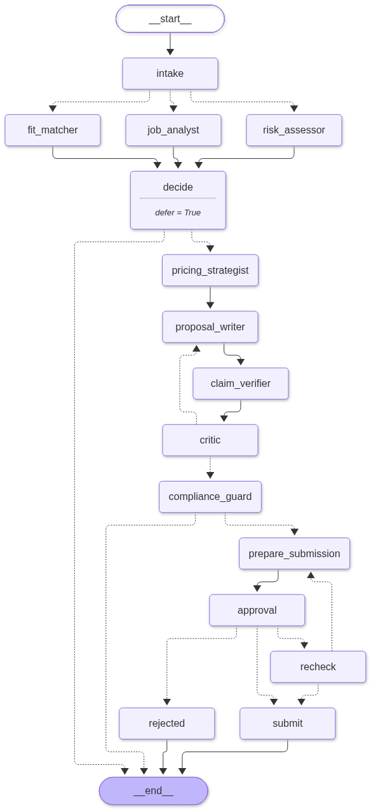
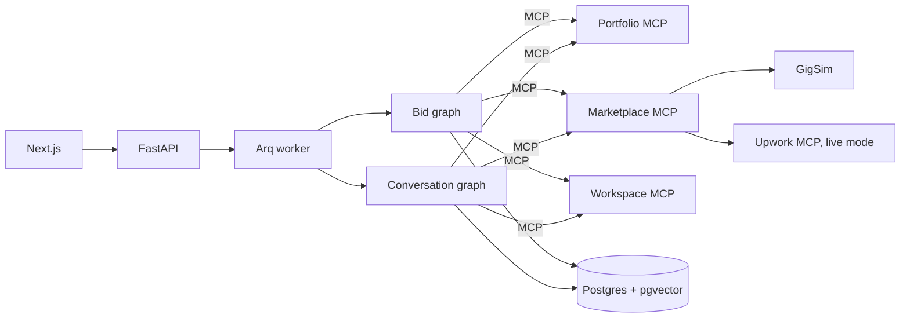

# GigBid

**A multi-agent copilot for freelancers.** GigBid finds jobs, flags scams, checks whether your
portfolio can prove you fit, prices the bid and drafts a proposal in which every claim links to
your own evidence. Nothing is sent until you approve it.

{{DEMO_GIF: 30-second GIF, inbox → job detail → proposal studio with evidence on hover → approve}}

**Live demo:** https://relationships-schools-crossing-bacon.trycloudflare.com. Reviewer login details are in the private submission comment. The
demo runs against GigSim, our marketplace simulator, on open-weight models.

## What it does

1. **Scouts** your saved searches on a schedule and drops reposts and duplicates.
2. **Analyses each job in parallel.** A Job Analyst extracts the spec, a Risk Assessor checks the
   client and flags scams, off-platform asks and prompt injections, and a Fit Matcher maps every
   requirement to items in your portfolio.
3. **Decides** bid, watch or skip from thresholds in config, and **prices** the bid from market
   data, the client's spend, your floor and the Connects cost.
4. **Drafts** a cover letter and screening answers that cite your evidence. A claim verifier
   rewrites anything your portfolio does not support, a Critic sends weak drafts back (twice at
   most), and a Compliance Guard removes contact details and guarantees.
5. **Stops for you.** You see the draft, the evidence behind each claim, the risk report, the
   price rationale and a dry-run preview of what will be sent and what it costs. Approve, edit or
   reject. Edits teach a style memory, but only through an explicit promotion rule.
6. **Handles replies.** It classifies client messages, drafts answers, proposes interview slots
   and keeps a pipeline board up to date.

It survives crashes: approvals live in Postgres checkpoints, and submissions carry idempotency
keys, so a proposal is submitted exactly once. When the marketplace is down, the UI says so,
queues the work and recovers.

## Architecture





Two hand-written LangGraph `StateGraph`s, three MCP servers of our own (Portfolio, Marketplace,
Workspace), one marketplace port with a GigSim adapter and a live Upwork adapter, and a human
`interrupt()` before every write. Details: [docs/ARCHITECTURE.md](docs/ARCHITECTURE.md).

## Results

Every number below comes from `evals/results/*.json`. `scripts/make_results_table.py` regenerates the full tables in `evals/results/tables.md`, and the block below is filled from them.
CI checks that each one appears in a results file (`scripts/ci_guards.py`).

<!-- results:start -->
**Retrieval and proposal quality (R&D question B)**

| Variant | Evidence Recall@5 | nDCG@10 | Unsupported claims / proposal | Judge score | GigSim reply rate | p95 latency (s) | Cost / proposal (USD) |
|---|---|---|---|---|---|---|---|
| V0 naive | {{RESULT: rag_variants.json → variants.v0_naive.overall.recall@5}} | {{RESULT: rag_variants.json → variants.v0_naive.overall.ndcg@10}} | {{RESULT: proposals.json → results.v0_naive.unsupported_after_mean}} | {{RESULT: proposals.json → results.v0_naive.judge_overall_mean}} | {{RESULT: proposals.json → results.v0_naive.gigsim_reply_rate}} | {{RESULT: proposals.json → results.v0_naive.latency.p95_s}} | {{RESULT: proposals.json → results.v0_naive.usage_per_proposal.cost_usd_mean}} |
| Best ({{RESULT: rag_variants.json → best_variant}}) | {{RESULT: rag_variants.json → variants.<best>.overall.recall@5}} | {{RESULT: rag_variants.json → variants.<best>.overall.ndcg@10}} | {{RESULT: proposals.json → results.<best>.unsupported_after_mean}} | {{RESULT: proposals.json → results.<best>.judge_overall_mean}} | {{RESULT: proposals.json → results.<best>.gigsim_reply_rate}} | {{RESULT: proposals.json → results.<best>.latency.p95_s}} | {{RESULT: proposals.json → results.<best>.usage_per_proposal.cost_usd_mean}} |

**Is multi-agent worth it? (R&D question C)**

| System | Bid/skip accuracy | Unsupported claims / proposal | Compliance violations caught | GigSim reply rate | Tokens / job | p95 latency (s) |
|---|---|---|---|---|---|---|
| (a) One ReAct agent with all tools | {{RESULT: multiagent.json → systems.react.bid_skip_accuracy}} | {{RESULT: multiagent.json → systems.react.unsupported_claims_per_proposal}} | {{RESULT: multiagent.json → systems.react.violations_caught_before_approval}} | {{RESULT: multiagent.json → systems.react.gigsim_reply_rate}} | {{RESULT: multiagent.json → systems.react.tokens_per_job}} | {{RESULT: multiagent.json → systems.react.latency_p95_s}} |
| (b) Prebuilt supervisor | {{RESULT: multiagent.json → systems.supervisor.bid_skip_accuracy}} | {{RESULT: multiagent.json → systems.supervisor.unsupported_claims_per_proposal}} | {{RESULT: multiagent.json → systems.supervisor.violations_caught_before_approval}} | {{RESULT: multiagent.json → systems.supervisor.gigsim_reply_rate}} | {{RESULT: multiagent.json → systems.supervisor.tokens_per_job}} | {{RESULT: multiagent.json → systems.supervisor.latency_p95_s}} |
| (c) GigBid graph | {{RESULT: multiagent.json → systems.graph.bid_skip_accuracy}} | {{RESULT: multiagent.json → systems.graph.unsupported_claims_per_proposal}} | {{RESULT: multiagent.json → systems.graph.violations_caught_before_approval}} | {{RESULT: multiagent.json → systems.graph.gigsim_reply_rate}} | {{RESULT: multiagent.json → systems.graph.tokens_per_job}} | {{RESULT: multiagent.json → systems.graph.latency_p95_s}} |
<!-- results:end -->

What ships: {{RESULT: rag_variants.json → best_variant}} is the retrieval variant in
`agent/config.yaml` (`rag.variant`). The full write-up, including negative results, is in
[docs/report/REPORT.md](docs/report/REPORT.md).

### Public traces

- A scam that was skipped: {{TRACE_URL: skipped scam}}
- An approved proposal, including a Critic loop: {{TRACE_URL: approved proposal with Critic revision}}
- A crash and resume with exactly-once submission: {{TRACE_URL: crash and resume}}

## Quick start

```bash
# Python 3.12 + uv, Node 22, a Postgres URL (Neon free tier is fine)
uv sync --extra dev
cp .env.example .env            # set DATABASE_URL, GROQ_API_KEY, REVIEWER_PASSWORD (see docs/RUNBOOK.md §3)
cd apps/web && npm ci && cd ../..
python scripts/dev.py --web     # GigSim, 3 MCP servers, API and web on http://localhost:3000
```

Or everything in containers:

```bash
docker compose -f infra/docker-compose.yml up --build
```

Tests: `uv run pytest -q tests/unit tests/contract gigsim/tests` and, in `apps/web`,
`npx playwright test`. One grounded proposal from the command line:
`python -m agent.runner job_001 --persona ai_ml` (`job_001` is in the built-in GigSim fixtures;
with another seed, pick an id from `GET /v1/jobs`).

**Use the Portfolio MCP server in Claude Desktop or Cursor** (read-only, stdio):

```json
{"mcpServers": {"gigbid-portfolio": {
  "command": "uv", "args": ["run", "--directory", "/path/to/gigbid", "python", "-m", "mcp_servers.portfolio.server", "--stdio"],
  "env": {"PORTFOLIO_PERSONA": "ai_ml"}}}}
```

Set `GIGBID_PERSONAS_DIR` to point it at your own portfolio folder.

## Repository map

| Path | What is there |
|---|---|
| `agent/` | LangGraph graphs (`graphs/`), one file per agent (`nodes/`), typed state and Pydantic hand-offs, prompts (`prompts/`, one versioned file per node), memory with promotion rules, MCP client and allowlists, the marketplace port, `config.yaml` (models, thresholds, budgets, policy) |
| `mcp_servers/` | Portfolio (read-only), Marketplace (read and write, GigSim and Upwork adapters), Workspace (calendar slots and email drafts) |
| `rag/` | Ingestion, index (dense + BM25), retrieval variants V0–V8, claim verification |
| `apps/api/` | FastAPI: auth, jobs, proposals, approvals, messages, runs (SSE), analytics, OAuth |
| `apps/web/` | Next.js app: inbox, job detail, proposal studio, pipeline, messages, run viewer, analytics, settings. Playwright tests in `tests/e2e/`. |
| `worker/` | Arq tasks and schedules: scouting, agent runs, event sync, degraded-mode replay |
| `gigsim/` | The marketplace simulator (FastAPI + SQLite), frozen after v1.0 |
| `evals/` | Datasets (dev set only), runners, results JSON |
| `infra/` | `docker-compose.yml`, one Dockerfile per service, the Hugging Face Space image |
| `data/` | Synthetic personas, policy pack, deploy seed (raw and processed data are git-ignored) |
| `docs/` | Architecture, ADRs, tools, runbook, data card, extension, AI usage, report |

## Pinned versions

Python dependencies are locked in `uv.lock`, and web dependencies in `apps/web/package-lock.json`.

| Package | Version |
|---|---|
| langgraph | 1.2.22 |
| mcp (official Python SDK) | 1.30.0 |
| langchain-mcp-adapters | 0.3.2 |
| fastapi | 0.163.0 |
| fastembed | 0.9.1 |
| next | 16.4.6 |
| react | 19.3.0 |

## Data and attribution

Job data is derived from public Kaggle datasets. Personas, portfolios, clients, past proposals and
outcome labels are synthetic and marked `synthetic: true`. Full details:
[docs/DATA_CARD.md](docs/DATA_CARD.md).

| Dataset | Licence | Use |
|---|---|---|
| asaniczka, *Upwork Job Postings Dataset 2024 (50k records)* | ODC-By | GigSim job corpus, dev and held-out jobs |
| asaniczka, *All Jobs on Upwork (200k+)* | ODC-By | Posted-price statistics |
| ahmedmyalo, *Upwork Freelance Jobs 60k* | Apache-2.0 | Skill-tag labels, out-of-distribution test pool |
| asaniczka, *Freelance Contracts Dataset (1.3 million entries)* | ODC-By | Realised hourly rates (fair price band), aggregates only |
| sarveshchhetri, *Freelancer Success, Earnings and Churn Prediction* | Apache-2.0 | GigSim competitor strength (itself synthetic) |
| adityammantri, *trial-1* (fake job posting detection) | Unknown | Risk Assessor external check only. Never committed or redistributed. |

GigBid never scrapes any website. Live Upwork access goes only through Upwork's official MCP
server, and every write there is a draft you confirm on Upwork.

## Documentation

- [Architecture](docs/ARCHITECTURE.md) and [decision records](docs/adr/)
- [MCP tools](docs/TOOLS.md)
- [Runbook](docs/RUNBOOK.md): running, configuration, drills, deployment, limitations
- [Data card](docs/DATA_CARD.md) and [labelling rules](evals/datasets/LABELING.md)
- [Extension X2: proposal A/B tests](docs/EXTENSION.md)
- [R&D report](docs/report/REPORT.md)
- [AI usage](docs/AI_USAGE.md)
- Specs: [GigSim](docs/specs/GIGSIM_SPEC.md), [data](docs/specs/DATA_SPEC.md)
