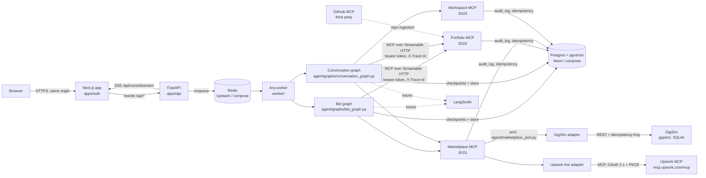
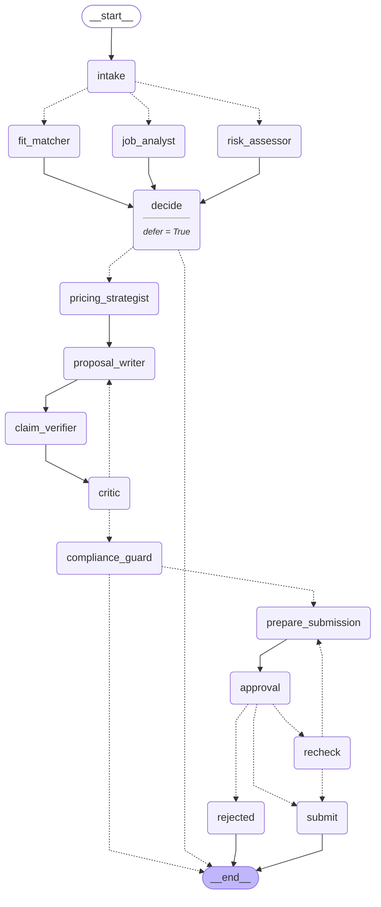
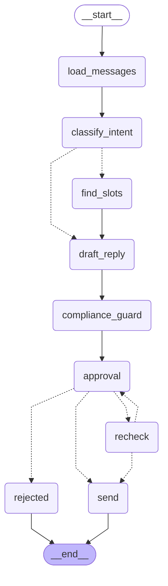

# Architecture

GigBid is a web app in which LangGraph agents find freelance jobs, judge whether to bid, draft
proposals grounded in portfolio evidence and handle client replies. A human approves every
proposal and message before it leaves the system. This document describes what the code does today.
Every claim names the file that implements it.

Related documents: [TOOLS.md](TOOLS.md) (MCP surface), [RUNBOOK.md](RUNBOOK.md) (operations),
[adr/](adr/) (decisions), [DATA_CARD.md](DATA_CARD.md) (data).

## 1. The whole system

| Box | Code | Runs as |
|---|---|---|
| Next.js app | `apps/web/src/app/*`, `apps/web/next.config.ts` | `next` standalone server. `/api/*` is rewritten to FastAPI, so the session cookie stays first-party. |
| FastAPI | `apps/api/main.py`, `apps/api/routers/*`, `apps/api/service.py` | uvicorn on :8000 |
| Arq worker | `worker/main.py` (`WorkerSettings`), `worker/tasks.py` | `arq worker.main.WorkerSettings`. With `WORKER_MODE=inline` or no `REDIS_URL`, `apps/api/jobs_queue.py` runs the same task functions as asyncio tasks inside the API. |
| Graph engine | `apps/api/runs.py` (`Engine`, `execute`, `mirror`) | Inside the worker (or the API in inline mode) |
| MCP servers | `mcp_servers/{portfolio,marketplace,workspace}/server.py` | One process each, Streamable HTTP, `common/mcp_http.py` bearer auth |
| GigSim | `gigsim/app.py`, `gigsim/service.py`, `gigsim/client_model.py` | uvicorn on :8081, own SQLite file |
| Postgres | `common/db.py` (`SCHEMA`), `agent/memory/store.py` | `pgvector/pgvector:pg16` in compose, Neon when deployed |
| Redis | `worker/main.py` `redis_settings()` | `redis:7-alpine` in compose, Upstash when deployed |
| LangSmith | Environment only (`LANGSMITH_TRACING`, `LANGSMITH_API_KEY`); links built in `apps/api/runs.py` `langsmith_url()` | SaaS |

Deployment packs everything except Postgres and Redis into one Hugging Face Docker Space
(`infra/hf/Dockerfile`, `infra/hf/supervisord.conf`). `infra/docker-compose.yml` runs the same
services as separate containers. See [ADR 0007](adr/0007-hf-space-deployment.md).

## 2. The two graphs

Both graphs are hand-written `StateGraph`s compiled with the Postgres checkpointer and store
(`apps/api/runs.py` `Engine.open()`). The rendered PNG is `docs/images/bid_graph.png`. The Mermaid
below is generated from the compiled graphs (`docs/images/*.mmd`).

### 2.1 Bid graph: one thread per job (`agent/graphs/bid_graph.py`)

Thread id: `bid-{user_id}-{job_id}` (`apps/api/service.py` `analyze()`, `worker/tasks.py`
`analyse_job()`).

How the edges are decided:

| Edge | Function | Rule |
|---|---|---|
| intake → three analysts | `fan_out()` | Three `Send`s, so Job Analyst, Risk Assessor and Fit Matcher run in parallel. |
| analysts → decide | `decide` is added with `defer=True` | Waits for all three branches. |
| decide → pricing or END | `decide()`, `after_decide()` | Skip if `risk.score > thresholds.maximum_risk_score`, or `fit.score < watch_fit_score`. Watch if fit is below `minimum_fit_score`, or the client's top rate is under 80% of the user's floor. Otherwise bid. Thresholds come from `agent/config.yaml`. |
| critic → writer or compliance | `after_critic()` | Back to the Writer while the last critique failed and `revisions < budgets.max_revisions` (2). |
| compliance → prepare_submission or END | `after_compliance()` | END (status `needs_attention`, reason shown in the UI) when `ComplianceVerdict.allowed` is false. |
| approval → submit / recheck / rejected | `after_approval()` | From the human's `ApprovalResponse.action`. |
| recheck → submit or prepare_submission | `after_recheck()` | An edit is re-checked by Compliance. If it still has violations, a new dry run and a new approval follow. |

### 2.2 Conversation graph: one thread per client conversation (`agent/graphs/conversation_graph.py`)

Thread id: `conv-{user_id}|{conversation_id}` (`apps/api/runs.py` `Engine.graph_for()`).

`classify_intent` combines a regex for off-platform and payment asks (`SCAM`), the injection
detector (`agent/guardrails.py` `injection_signal`) and an LLM intent label
(`question | negotiation | interview_request | scam_signal | other`, `agent/handoffs.py`
`MessageIntent`). Any regex or injection flag forces `scam_signal`. Interview requests go through
`find_slots` (Workspace `free_slots`). Marketplace events start conversations: `worker/tasks.py`
`sync_events()` creates a `conversations` row on `client_replied` / `interview_requested`, and the
user starts a draft from the Messages screen (`POST /api/messages/{id}/draft`).

## 3. Why each agent exists

| Agent | Node / code | Why it is a separate step |
|---|---|---|
| Scout | `agent/nodes/scout.py` `scout()`, called by `worker/tasks.py` `scout_user()` | Runs saved searches on a schedule and removes duplicates by id and by text fingerprint. It makes no LLM call, so it is cheap enough to run every few minutes. |
| Job Analyst | `agent/nodes/analyst.py` | Turns free text into a `JobSpec` (deliverables, skills, timeline, screening questions, hidden needs) that the later steps decide on. |
| Risk Assessor | `agent/nodes/risk_assessor.py` | Scam, free-work, off-platform and injection checks. It needs client history and has to be able to veto a job whatever the fit. Regex floors stop the model from talking a scam score down. |
| Fit Matcher | `agent/nodes/fit_matcher.py` | Maps each requirement to portfolio evidence through the Portfolio MCP server. It drops evidence ids that retrieval did not return. The fit score is computed from graded coverage per requirement (full = 1, partial = 0.5, none = 0), averaged, rather than taken from the model. |
| Decision (`decide`) | `agent/graphs/bid_graph.py` `decide()` | A deterministic rule over the three reports, so a skip can be explained by thresholds in config. |
| Pricing Strategist | `agent/nodes/pricing.py` `quote()` | Deterministic: market percentiles, client spend, the user's floor, and whether the Connects cost is worth it. Every number in its rationale comes from a tool result or config. |
| Proposal Writer | `agent/nodes/writer.py` | Drafts the cover letter and screening answers, citing evidence ids. It applies promoted style rules and outcome hints. |
| Claim verifier | `agent/nodes/verifier.py` → `rag/verify.py` `verify_draft()` | Splits the draft into claims, labels each against the evidence and rewrites unsupported ones before the Critic sees the draft ([ADR 0011](adr/0011-claim-verification-before-critic.md)). |
| Critic | `agent/nodes/critic.py` | Deterministic checks (length, generic opening, buzzwords, unanswered questions, missing citations) plus an LLM review. Sends the draft back at most twice. |
| Compliance Guard | `agent/nodes/compliance.py` `check()` | Config regexes first (they cannot be argued with), then an LLM pass over `data/policy_pack/marketplace_policy.md`. Redacts sentences, appends the policy's required disclosure, blocks when unsupported claims or unremovable violations remain. No MCP access. |
| Client Liaison | `agent/graphs/conversation_graph.py` (`classify_intent`, `find_slots`, `draft_reply`, `send`) | Reads client messages (untrusted), drafts replies and interview slots, and stops for approval. `agent/nodes/client_liaison.py` is an unused starter stub; the liaison logic lives in the graph file. |

## 4. State, execution trace and long-term memory

These three are kept apart, as `agent/state.py` states at the top.

| | What it holds | Where it lives | Written by | Read by |
|---|---|---|---|---|
| **State** | What one job or conversation needs now: `job`, `job_spec`, `risk_report`, `fit_report`, `evidence`, `decision`, `price_quote`, `draft`, `verification`, `critiques`, `revisions`, `compliance`, `dry_run`, `approval`, `submission`, `status`, `errors` | `agent/state.py` `BidState` / `ConversationState` (TypedDicts holding the Pydantic hand-offs from `agent/handoffs.py`). Checkpointed after every step by `AsyncPostgresSaver` (`agent/memory/store.py` `open_persistence()`). The serializer only accepts classes from `agent.handoffs`. | Graph nodes | The next node, the UI through `apps/api/service.py` `studio()` / `job_detail()`, and `mirror()`, which copies list fields into the `jobs` and `proposals` tables. |
| Reducers | Parallel branches writing the same field | `evidence: Annotated[..., merge_evidence]` (one copy per id, best score), `critiques` / `errors`: `operator.add`, `status`: `last` | | |
| **Execution trace** | Every tool name, argument, result, node start/end, timings, tokens and cost | 1) `audit_log` table, append-only, PII-masked (`common/mcp_http.py` `audit()`), with user, server, tool, args, result, ok, trace_id. 2) `run_events` table (`apps/api/runs.py` `_emitter()`), which feeds the SSE run viewer. 3) `runs` table: tokens, cost, latency, per-node usage (`agent/llm.py` `Usage`). 4) LangSmith. | MCP servers; the `@node` decorator in `agent/nodes/common.py`; `agent/llm.py` | Run viewer, analytics, audits, evals. Never fed back into prompts. |
| **Long-term memory** | Promoted knowledge only | LangGraph `AsyncPostgresStore`, namespaces `("style", user)` and `("outcome", user)`. Working counters sit in `("style_candidates", user)` and `("outcome_counts", user)`. | Only `agent/memory/promotion_rules.py` | Writer and Liaison (`style_rules()`), Writer and Pricing (`outcome_hint()`), Settings → memory viewer (`GET/DELETE /api/memory`). |

The promotion rules (`agent/memory/promotion_rules.py`):

- **Style.** `observe_edit()` diffs the draft against the user's edit (`difflib`) and asks the
  small model for at most 3 general rules. `observe_rejection()` does the same for rejection
  reasons of 3 words or more. Each rule is a candidate with a counter. It is promoted into
  `("style", user)` only when seen `memory.style_promotion_min_occurrences` times (2 in
  `agent/config.yaml`). Rules containing 3+ digit numbers, `@` or URLs are dropped, so client
  specifics never get in. At most `style_max_rules` (12) are kept, and the oldest is evicted first.
  Deleting a rule in the UI also deletes its candidate counter (`apps/api/service.py`
  `delete_memory()`), so it is not re-promoted from old counts.
- **Outcome.** `record_outcome()` runs only from marketplace events (`worker/tasks.py`
  `sync_events()`). It keeps counts per category and promotes reply rate, hire rate and best style
  once `outcome_min_samples` (3) outcomes exist. Raw tool output is never stored.

## 5. The marketplace port

`agent/marketplace_port.py` defines `MarketplacePort`, the one interface with read methods
(`search_jobs`, `get_job`, `get_client_history`, `get_connects_balance`, `get_market_stats`,
`get_policy`, `list_proposals`, `list_threads`, `list_messages`, `get_events`, `health`) and
write methods (`create_proposal_draft`, `submit_proposal`, `send_message`). Two adapters implement it:

| Adapter | File | Behaviour |
|---|---|---|
| `GigSimAdapter` | `mcp_servers/marketplace/adapters/gigsim.py` | REST to GigSim with an account bearer token. Sends `Idempotency-Key` on writes. Timeouts and bounded retries with backoff on 429 / 5xx (`marketplace.timeout_seconds`, `max_retries`). Connection failures raise `MarketplaceUnavailable`. |
| `UpworkLiveAdapter` | `mcp_servers/marketplace/adapters/upwork_live.py` | Connects to `https://mcp.upwork.com/mcp` through `MultiServerMCPClient` with the user's OAuth access token (stored Fernet-encrypted in `oauth_tokens`, `common/security.py`). Maps Upwork's tools onto the port by keyword rules (`TOOL_RULES`), or by names pinned in `marketplace.upwork_tool_map` if that key is added to config. `submit_proposal` never submits: it returns `draft_awaiting_confirmation_on_upwork`. Market statistics fall back to the offline Kaggle-derived stats. |

The adapter is chosen inside the Marketplace MCP server (`mcp_servers/marketplace/server.py`
`adapter_for()`): the user's profile field `marketplace_mode` wins, then `marketplace.mode` in
`agent/config.yaml`, which the `MARKETPLACE_MODE` environment variable overrides
(`agent/settings.py`). Agents only see MCP tool names, so nothing under `agent/` changes when
the adapter changes. `adapter_for()` caches one adapter per user in process memory, so the
Marketplace MCP server must be restarted after a mode switch.

## 6. MCP surface

Full tool table with annotations: [TOOLS.md](TOOLS.md).

| Server | Tools | Resources / prompts | Auth |
|---|---|---|---|
| Portfolio (read-only) `mcp_servers/portfolio/server.py` | `search_evidence`, `get_case_study`, `list_skills` | Resources `portfolio://case/{evidence_id}`, `portfolio://proposal/{evidence_id}`, `portfolio://profile/{persona_id}`. Prompts "Answer a screening question from my portfolio", "Which of my projects prove I fit this job?", "Outline a cover letter grounded in my work". | Bearer over HTTP. None over stdio (`--stdio`, for Claude Desktop or Cursor). |
| Marketplace (read + write) `mcp_servers/marketplace/server.py` | 10 read tools, 3 write tools | | Bearer. Per-user token bucket (`common/mcp_http.py` `RateLimiter`, `marketplace.max_requests_per_minute`). |
| Workspace `mcp_servers/workspace/server.py` | `free_slots`, `create_interview_hold`, `create_email_draft` | | Bearer. Local mock backed by the `workspace_items` table, not Google APIs. |
| Upwork (third party) | Discovered at connect time | | OAuth 2.1 + PKCE, client ID metadata document |
| GitHub (third party) | Official GitHub MCP server, for repo ingestion | | GitHub token |

Per-agent allowlists live in `agent/mcp_client.py` `ALLOWLIST`. `AgentTools.call()` raises
`PermissionError` for a tool outside an agent's list. In the production graphs no LLM chooses
tools at all: nodes call tools from code with fixed arguments, and the allowlist is a second fence.

## 7. Approvals and exactly-once submission

1. `prepare_submission` calls `create_proposal_draft(..., dry_run=True)` and stores the preview
   (text with citations stripped, bid, rate type, Connects cost, marketplace) in `state["dry_run"]`.
2. `approval` builds an `ApprovalRequest` (draft, evidence, risk report, price rationale,
   critiques, compliance verdict, dry run) and calls `interrupt()`. The checkpoint is in Postgres,
   so the pending approval survives a refresh, an API restart or a worker restart.
   `apps/api/service.py` `studio()` reads it back from `snap.tasks[*].interrupts`.
3. `POST /api/approvals/{thread_id}` (`apps/api/service.py` `decide()`) checks that something is
   pending, requires a reason to reject and text to edit, logs the decision in `feedback`, and
   enqueues `run_resume`. The worker resumes the thread with `Command(resume=answer)`
   (`agent/runner.py` `resume()`).
4. `submit` computes idempotency keys with `idem_key(state, step)`:
   `step + "-" + sha256(user_id | job_id | draft.version | sha256(cover_letter))[:40]`. The same
   approved draft always gives the same keys. An edited draft gets a new version and new keys.
5. The Marketplace MCP server's `_write()` looks up `(user_id, tool, key)` in the `idempotency`
   table. A hit with the same request hash returns the stored first response with
   `idempotent_replay=True`, without calling the adapter. A hit with a different hash fails with
   `idempotency_conflict`. Dry runs are never stored.
6. GigSim also deduplicates on the `Idempotency-Key` header (`docs/specs/GIGSIM_SPEC.md`), so two
   concurrent first attempts that both miss the table still spend Connects once.

A crash at any point after approval therefore replays to the same result. The conversation graph's
`send` node uses the same pattern with key `msg-sha256(user | conversation | text)`. Workspace writes
(`create_interview_hold`, `create_email_draft`) carry no idempotency key. They do not send
anything, and the current graphs do not call them.

## 8. Degraded mode

| Layer | What happens when the Marketplace MCP server (or GigSim) is down |
|---|---|
| Tool loading | `agent/mcp_client.py` `ToolBox.http()` skips a server it cannot reach, so its tools are missing. |
| Tool call | `AgentTools.call()` raises `MarketplaceUnavailable` for a missing marketplace tool, and also after bounded retries (2 retries, exponential backoff with jitter, 30 s timeout per call) on connection errors or `marketplace_unavailable` / `upstream_unavailable` payloads. 429 payloads sleep for `retry_after` and retry. |
| Graph | `bid_graph.transient()` does not retry `MarketplaceUnavailable`; it propagates out of `agent/runner.py` `run_graph()`. |
| Run engine | `apps/api/runs.py` `execute()` checks `box.available("marketplace")` before starting, marks the run `queued`, emits a `marketplace` error event, and re-raises. |
| Worker | `worker/tasks.py` `run_start` / `run_resume` / `scout_user` catch it and insert a row into `work_queue`. The cron `retry_queued` (every minute) replays up to 10 queued items once `health()` reports `ok`. |
| API | `GET /api/health` (`apps/api/service.py` `health()`) probes the database, each MCP server (`tools/list`) and GigSim, and returns `degraded` with `queued_while_degraded`. Synchronous endpoints that need the marketplace return 503 `marketplace_unavailable` (`apps/api/main.py` exception handler). |
| UI | `apps/web/src/components/DegradedBanner.tsx` polls `/api/health` every 20 s and also reacts to any 503. It shows "Marketplace unavailable: work is queued and will resume automatically" with the queued count and the affected services. Tested by `apps/web/tests/e2e/degraded.spec.ts`. |

## 9. Model routing per node

The model for every node comes from `agent/config.yaml` (`models.nodes` maps node → tier, and
`models.profiles.<profile>.<tier>` maps tier → model), resolved in `agent/settings.py`
`model_spec()` and built in `agent/llm.py` `get_model()`. Nodes call `llm.structured(node, ...)`
or `llm.text(node, ...)` and never build models themselves.

| Node (config key) | Tier | `open` (default, Groq) | `paid` | Used by |
|---|---|---|---|---|
| `analyst` | small | `openai/gpt-oss-20b` | `claude-haiku-5-5` (effort low) | Job Analyst |
| `risk_assessor` | small | `openai/gpt-oss-20b` | `claude-haiku-5-5` | Risk Assessor |
| `fit_matcher` | small | `openai/gpt-oss-20b` | `claude-haiku-5-5` | Fit Matcher (requirement split and matching), V8 evidence grading |
| `pricing` | small | (no LLM call) | (no LLM call) | Pricing is deterministic |
| `scout` | small | (no LLM call) | (no LLM call) | Scout is deterministic |
| `writer` | strong | `openai/gpt-oss-120b` | `claude-haiku-5-5` (effort medium) | Writer, paragraph regeneration |
| `verifier` | small | `openai/gpt-oss-20b` | `claude-haiku-5-5` | Claim splitter, labeller, rewriter |
| `critic` | strong | `openai/gpt-oss-120b` | `claude-haiku-5-5` (effort medium) | Critic |
| `compliance` | small | `openai/gpt-oss-20b` | `claude-haiku-5-5` | Compliance LLM pass, style-memory rule extraction |
| `liaison_intent` | small | `openai/gpt-oss-20b` | `claude-haiku-5-5` | Intent classification |
| `liaison` | strong | `openai/gpt-oss-120b` | `claude-haiku-5-5` (effort medium) | Reply drafting |
| `judge` (eval only) | judge | `claude-haiku-5-5` | `claude-haiku-5-5` | `evals/runners/proposal_eval.py` rubric. A different model family from the gpt-oss writer. |

- **Fallbacks** (`agent/llm.py` `_invoke_with_fallback`): on any error a small node retries on
  `fallback_small` and a strong node on `fallback_strong`. In `open` these are `gpt-oss-120b` and
  `gpt-oss-20b`, which sit in different Groq rate-limit buckets. `paid` defines only `fallback_small`.
- **Other profiles**: `open_alt` (all `qwen/qwen3.8-27b`, the second open configuration for the
  required comparison) and `open_local` (Ollama `qwen3:4b` / `qwen3:8b`, the compose `ollama`
  service). A user picks a profile in Settings (`ProfileIn.model_profile`), and `MODEL_PROFILE`
  sets the default.
- **Not LLMs**: embeddings `BAAI/bge-small-en-v1.5` (alternative `nomic-ai/nomic-embed-text-v1.5`)
  and reranker `Xenova/ms-marco-MiniLM-L-6-v2`, on CPU through fastembed (`rag/index/embeddings.py`).
  The injection classifier is `meta-llama/llama-prompt-guard-2-86m` on Groq (`agent/guardrails.py`).
- **Budgets**: `agent/llm.py` `_record()` raises `BudgetExceeded` above
  `budgets.max_tokens_per_job`, and `recursion_limit = budgets.max_graph_steps`. Either one moves
  the run to `needs_attention` (`agent/runner.py`). Per-node token and USD totals use
  `models.prices`.

## 10. Retrieval

The Portfolio MCP server's `search_evidence` calls `rag/retriever.py` `search()`, which builds
the variant named by `rag.variant` in `agent/config.yaml`. Each variant in `rag/variants/` is a
preset of the switches in `rag/variants/base.py` `PipelineConfig`: `decompose`, `hybrid`
(BM25 via `bm25s` + dense, reciprocal rank fusion), `rerank`, `outcome`, `contextual`, `hyde`,
`corrective`. The shipped value is set from `evals/results/rag_variants.json`
(`{{RESULT: rag_variants.json → best_variant}}`). Dense search runs over an in-process numpy
matrix per (tenant, persona) (`rag/index/store.py` `EvidenceIndex`). `PgVectorStore` in the
same file holds the tenant-scoped pgvector table, but the request path does not use it yet
([ADR 0002](adr/0002-pgvector-over-qdrant.md)).

## 11. Known gaps between this design and the code

These are written down so nobody is surprised in the viva.

- **Trace id.** `apps/api/main.py` sets an `x-trace-id` per HTTP request, but `apps/api/runs.py`
  `execute()` generates a fresh `trace_id` per graph step. That fresh id is what reaches the MCP
  servers (`X-Trace-Id`) and `audit_log`. The id stored for the LangSmith link in `new_run()` is a
  third value, and graph runs are not tagged with `trace_id` metadata, so the "View trace" link's
  metadata filter may match nothing. See [ADR 0008](adr/0008-langsmith-tracing.md).
- **Uploads.** `apps/api/service.py` `upload_portfolio()` stores uploads in `workspace_items`, but
  nothing calls `rag/retriever.py` `add_user_docs()`, so uploaded items are not searchable yet.
- **GitHub ingestion.** `rag/ingest/loaders.py` mentions `rag/ingest/github_ingest.py`, which does
  not exist in the tree at the time of writing. Persona repos are read from
  `data/personas/<persona>/repos/` on disk.
- **Liaison evidence lookup.** `conversation_graph.draft_reply()` calls the `search_evidence` tool
  directly from `ctx.toolbox.tools`, outside the `liaison` allowlist. It is a read-only portfolio
  tool, but it bypasses the allowlist check.
- **Streaming module.** The brief's `apps/api/streaming.py` does not exist. The SSE bridge is
  `apps/api/service.py` `stream_run()`.
